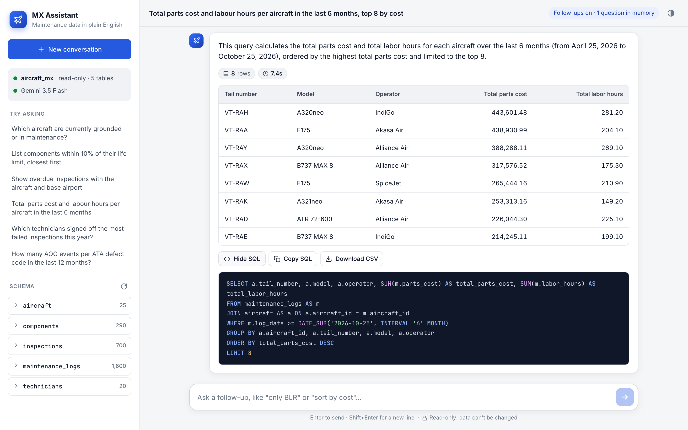
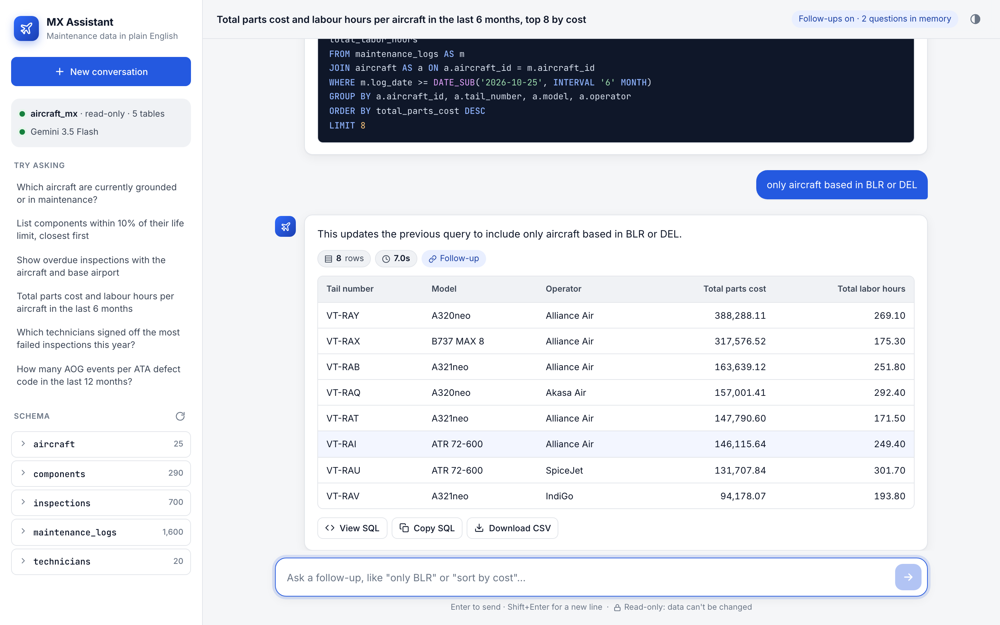
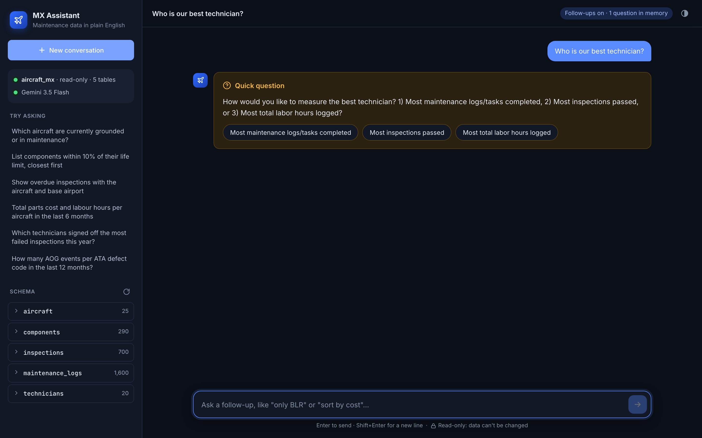
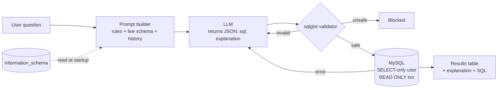

# MX Assistant — Natural Language to SQL for Aircraft Maintenance Data

Ask maintenance questions in plain English and get answers from MySQL, without writing SQL.

MX Assistant lets maintenance planners, engineers and support staff query aircraft component, inspection and maintenance-log data by typing questions like *"Which components are within 10% of their life limit?"*. An LLM writes the SQL from the live database schema. The app checks that the query is read-only, runs it through a SELECT-only database account, and shows the results with a plain-English explanation and the SQL behind them.



**Data retrieval dropped from about 15–20 minutes (asking a developer) to 3–8 seconds per question.**

---

## Features

- **Plain-English questions** answered from a live MySQL database
- **Schema-aware prompting:** reads tables, columns, keys, relationships, column comments and real sample values from `information_schema`
- **Read-only by design,** with four independent layers: prompt rules, sqlglot syntax-tree validation, SQL rebuilt from the validated tree, and a SELECT-only database user in a read-only transaction
- **Follow-up questions:** "only BLR", "sort by cost" refine the previous answer
- **Clarifying questions** for vague requests, with clickable options
- **Self-correction:** a failed query is sent back to the model with the error, once
- **Truncation warning** when a result exceeds the row cap
- **Scales to large schemas** through a table allowlist and automatic two-step table selection
- **Choice of LLM provider:** Google Gemini (default), OpenAI or Anthropic Claude; retries plus a fallback model
- **Custom web chat UI** (FastAPI with an HTML/CSS/JS front end) with light and dark themes; Streamlit UI included as an alternative
- **Audit log** of every question with its SQL, outcome, timing and token usage

<table>
  <tr>
    <td></td>
    <td></td>
  </tr>
  <tr>
    <td align="center"><sub>Follow-up refines the previous query</sub></td>
    <td align="center"><sub>Clarifying question with options (dark theme)</sub></td>
  </tr>
</table>

---

## How it works



The LLM only writes SQL. It never connects to the database or sees credentials. The application validates the query, rebuilds it, caps the rows and runs it.

---

## Quick start

**Prerequisites:** Python 3.11+, MySQL 8, and an API key for Gemini ([Google AI Studio](https://aistudio.google.com/)), OpenAI or Anthropic.

```bash
git clone https://github.com/diiyark123/nlptosql.git
cd nlptosql
python3 -m venv .venv && source .venv/bin/activate
pip install -r requirements.txt
cp .env.example .env
```

Edit `.env`:

- set your API key (`GEMINI_API_KEY`)
- set your MySQL admin password (`MYSQL_ADMIN_PASSWORD`, used only for setup)
- choose a password for the app's read-only user (`MYSQL_READONLY_PASSWORD`)

Then:

```bash
python db/setup_db.py              # create database, sample data and read-only user
uvicorn server:app --port 8000     # open http://localhost:8000
```

Alternative UI: `streamlit run streamlit_app.py`. Run the tests with `pytest` (63 tests; no database or API key needed).

---

## Configuration

| Variable | Default | Purpose |
|---|---|---|
| `LLM_PROVIDER` | `gemini` | `gemini`, `openai` or `anthropic` |
| `GEMINI_API_KEY` / `OPENAI_API_KEY` / `ANTHROPIC_API_KEY` | — | Key for the chosen provider |
| `GEMINI_MODEL` / `GEMINI_FALLBACK_MODEL` | `gemini-3.5-flash` / `gemini-3.5-flash-lite` | Main and fallback models |
| `MYSQL_DATABASE` | `aircraft_mx` | Database to query |
| `MYSQL_ADMIN_USER` / `MYSQL_ADMIN_PASSWORD` | `root` / — | Used only by setup scripts |
| `MYSQL_READONLY_USER` / `MYSQL_READONLY_PASSWORD` | `nl2sql_reader` / — | Account the app connects with (SELECT only) |
| `MAX_RESULT_ROWS` | `500` | Row cap per query |
| `QUERY_TIMEOUT_MS` | `15000` | MySQL execution timeout |
| `ALLOWED_TABLES` | *(all)* | Comma-separated list of the only tables the assistant may see |
| `SCHEMA_SELECTION_THRESHOLD` | `30` | Above this many tables, relevant tables are picked first |

Full reference: [Technical Design § 12](docs/TECHNICAL_DESIGN.md#12-configuration-reference).

---

## Project structure

```
server.py            FastAPI backend (API + serves the web UI)
streamlit_app.py     Alternative Streamlit UI
nl2sql/
  config.py          Settings from .env
  db.py              Schema introspection, read-only execution
  prompt.py          Prompt rules, schema rendering, table catalog
  llm.py             Gemini / OpenAI / Claude clients, structured output, retries
  validator.py       sqlglot read-only validation and LIMIT capping
  pipeline.py        Orchestration: selection, follow-ups, clarification, retry, audit
web/                 Front end: index.html, styles.css, app.js
db/                  schema.sql, setup_db.py, show_databases.py
tests/               63 pytest tests
docs/                Technical design document and screenshots
```

---

## Safety model

| Layer | What it does |
|---|---|
| 1. Prompt | The model must write a single SELECT and refuse data-change requests |
| 2. Validator | Parses with sqlglot and rejects multiple statements, any DML or DDL, GRANT, SET, `FOR UPDATE`, `INTO OUTFILE`, SLEEP, BENCHMARK, LOAD_FILE, system schemas, non-allowlisted tables and executable comments |
| 3. Rebuilt SQL | The executed SQL is regenerated from the validated syntax tree, with a LIMIT cap |
| 4. Database | The app connects as a user with only `SELECT` on one database, inside `START TRANSACTION READ ONLY` with a 15 s timeout |

Unsafe queries are blocked and never retried. In testing, the read-only user was denied DELETE, DROP and UPDATE by MySQL itself.

---

## Using your own database

Set `MYSQL_DATABASE`, give the read-only user `SELECT` on it, and optionally limit `ALLOWED_TABLES`. No code changes are needed. Adding `COMMENT`s to tables and columns (units, codes, business rules) is the most effective way to improve accuracy.

---

## Documentation

**[Technical Design Document](docs/TECHNICAL_DESIGN.md)** covers:

- requirements
- architecture and system design, with diagrams
- data model and API specification
- security and threat model
- configuration, setup and troubleshooting
- testing, performance, design trade-offs and the roadmap

## Roadmap

- **Evaluation set** with known answers, to measure query accuracy
- **Authentication** with per-role table access
- Answer feedback, cross-provider fallback, charts, and scheduled reports

## Note on data

The bundled `aircraft_mx` dataset is **synthetic**: 25 aircraft, 290 components, 700 inspections and 1,600 maintenance logs, generated with a fixed seed. It is realistic, but does not describe real aircraft, operators or people.
